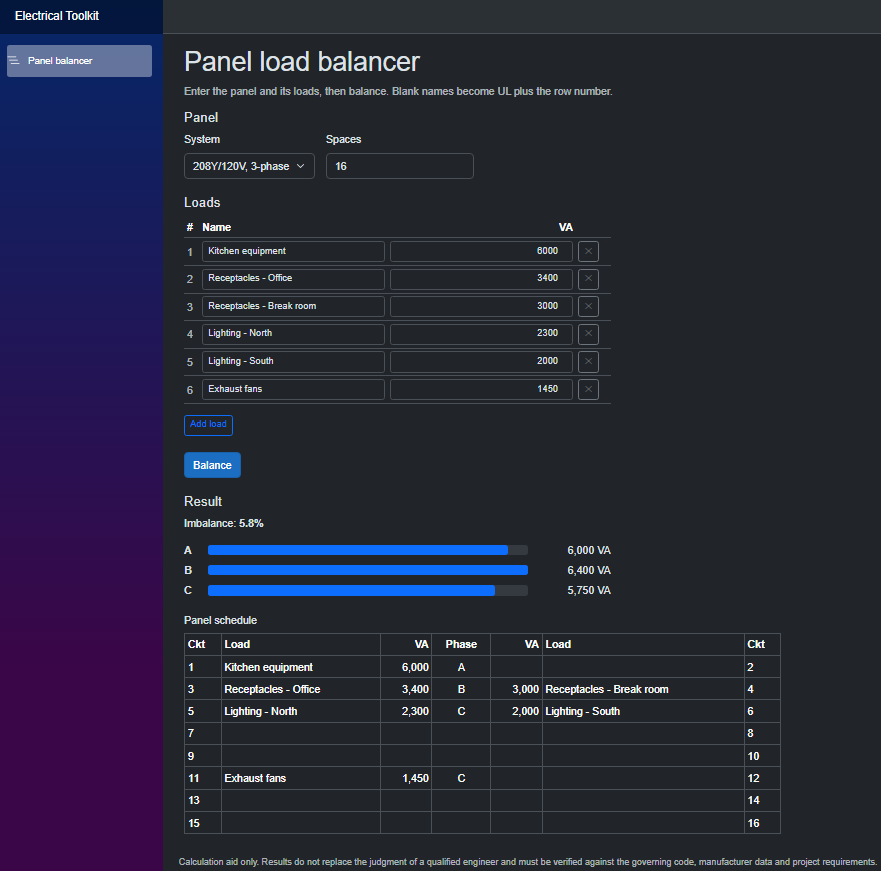

# Electrical Design Toolkit

[](https://github.com/cooperyungblut/electrical-toolkit/actions/workflows/ci.yml)

A set of calculation tools for electrical design work. The first one is a panel load balancer: give it a panel size and a list of loads, and it assigns breaker slots to keep the phases as even as possible.



## Try it

Live API (opens the interactive docs): https://electrical-toolkit.grayglacier-d0a2e1cb.centralus.azurecontainerapps.io

The first request after the app has been idle takes a few seconds while it starts up (it scales to zero when unused). After that it's fast.

## Current state

- 208Y/120V three-phase panels, single-pole loads
- Greedy balancer: largest load first, onto the lightest phase that still has open slots
- Local search: starts from greedy, then moves and swaps loads while that lowers the sum of squared phase totals
- Brute-force balancer (up to 12 loads), used in tests as the exact answer
- Imbalance % = largest deviation from the phase average, divided by the average

Greedy alone isn't always optimal. Loads of 6, 3, 3, 2, 2, 2 kVA come out 7/6/5 when 6/6/6 is possible, and local search fixes that case. On 500 random panels of 1 to 9 loads, compared against brute force:

| | Optimal |
|---|---|
| Greedy | 426 (85.2%) |
| Greedy + local search | 480 (96.0%) |

When local search misses, it is at most 3.0 imbalance points above optimal.

REST API (ASP.NET Core, .NET 10) with OpenAPI docs, deployed to Azure Container Apps from GitHub Actions.

Web UI (Blazor WebAssembly) served from the API: load entry, per-phase bars, panel schedule

## Planned

Web API, Docker, Azure deployment, 2- and 3-pole loads, saved panels, 120/240V and 480Y/277V panels. Later: conduit fill and voltage drop.

## Build

```
dotnet test
```

Requires .NET 10.

## AI assistance

*I wrote the core logic and its tests, with Claude reviewing my code along the way. Project scaffolding, CI config and this README were drafted with Claude's help.*

## Disclaimer

*This tool is a calculation aid. It does not replace the judgment of a qualified engineer, and results must be verified against the governing code, the equipment manufacturer's data, and project requirements before use.*
