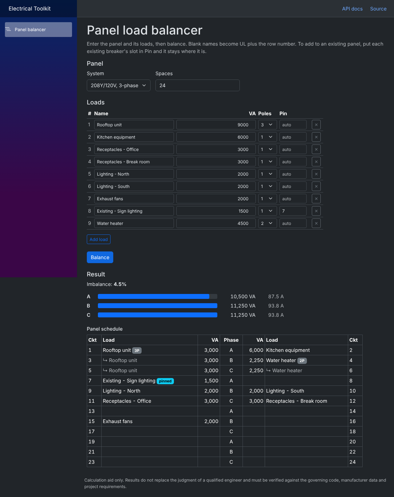

# Electrical Design Toolkit

[](https://github.com/cooperyungblut/electrical-toolkit/actions/workflows/ci.yml)

A set of calculation tools for electrical design work. The first one is a panel load balancer: give it a panel size and a list of loads, and it assigns breaker slots to keep the phases as even as possible.



## Try it

Live app: https://electrical-toolkit.grayglacier-d0a2e1cb.centralus.azurecontainerapps.io

API docs are at `/scalar`. The first request after the app has been idle takes a few seconds while it starts up (it scales to zero when unused). After that it's fast.

## Features

- Panels: 208Y/120V and 480Y/277V three-phase, 120/240V single-phase
- 1-, 2- and 3-pole loads. A 2-pole breaker takes slots n and n+2 (two different phases), a 3-pole takes n, n+2, n+4
- Pinned loads: give an existing breaker's slot and it stays put, so new loads can be balanced around an existing panel
- Results: phase totals in VA and amps, imbalance %, and a panel schedule
- REST API (ASP.NET Core, .NET 10) with OpenAPI docs, and a Blazor WebAssembly UI served from the same app
- Deployed to Azure Container Apps from GitHub Actions

## How it balances

Two stages:

1. **Pick phases.** Greedy places pinned loads first, then 3-pole, 2-pole and 1-pole loads, largest VA first, each on the option that adds least to the sum of squared phase totals. Local search then moves single loads, changes 2-pole phase pairs and swaps loads while that sum keeps going down.
2. **Pick slots.** Pinned breakers keep their slots. Multi-pole breakers take the lowest open run that matches their phases, backtracking if a later one doesn't fit. 1-pole breakers fill in. If a tight panel can't be packed, the API says so instead of guessing.

Multi-pole VA is split equally across poles. Imbalance % = largest deviation from the phase average, divided by the average. Phase amps = phase VA / line-to-neutral volts.

Greedy alone isn't always optimal. Loads of 6, 3, 3, 2, 2, 2 kVA come out 7/6/5 when 6/6/6 is possible, and local search fixes that case. On 500 random panels of 1 to 9 single-pole loads, compared against a brute-force solver:

| | Optimal |
|---|---|
| Greedy | 426 (85.2%) |
| Greedy + local search | 480 (96.0%) |

When local search misses, it is at most 3.0 imbalance points above optimal.

## Planned

Saved panels, CSV import. Later: conduit fill and voltage drop.

## Build

```
dotnet test
```

Requires .NET 10.

## AI assistance

*I wrote the original core logic and its tests (slot mapping, greedy, local search, brute force), with Claude reviewing my code along the way. Project scaffolding, CI config and this README were drafted with Claude's help. Claude then extended those balancers for multi-pole loads and wrote the slot packer, pinned loads, the 480Y/277V and 120/240V systems, phase amps and the matching UI.*

## Disclaimer

*This tool is a calculation aid. It does not replace the judgment of a qualified engineer, and results must be verified against the governing code, the equipment manufacturer's data, and project requirements before use.*
